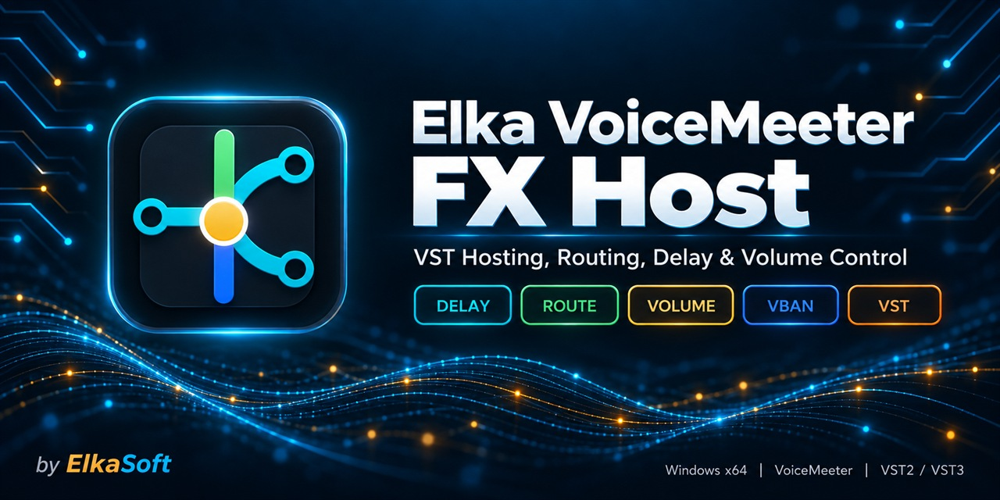

# Elka VoiceMeeter FX Host



[Horizontal artwork](docs/images/fx-host-social-preview.jpg) | [Vertical artwork](docs/images/fx-host-vertical.jpg) - JPG copies under 1 MB.

Elka VoiceMeeter FX Host is a Windows control surface and VST host for
VoiceMeeter. It adds delay, volume, direct routing, VST processing, VST groups,
ASIO Patch operation, and VBAN-TEXT control without sending audio through a
separate DAW or plugin host.

The canvas is read from **left to right**:

```text
VoiceMeeter source -> VST or VST group -> VoiceMeeter destination
```

The important rule is simple: after a source is connected into a VST path, that
audio path is intentionally silent until the chain reaches a destination on the
right. This prevents an incomplete processing chain from leaking dry audio.

[Download the latest release](https://github.com/torment78/Elka.VoiceMeeterFxHost/releases/latest)

**0.8.3.0 is the signed stable Windows release.** It adds **Donate** buttons in
the menu and at the bottom of the left sidebar, opening the
[ElkaSoft Ko-fi page](https://ko-fi.com/msffixit). Audio processing and routing
are unchanged. The installer, application, embedded worker and native libraries
are digitally signed and timestamped. Portable downloads contain the same
signed binaries; SHA-256 checksums accompany the release.

**[0.8.3.8 is the unsigned development prerelease](https://github.com/torment78/Elka.VoiceMeeterFxHost/releases/tag/v0.8.3.8).**
Endpoint nodes now have horizontal VU meters, with two channels when compact
and all eight when expanded. **Menu > Settings** can turn them off and opens
the **Hotkey** window for global VST/group actions: open/close, bypass, power,
combined bypass/power, and VST reload or properties. VST and group power/bypass
controls can optionally be linked. Node meters now target 60 Hz with smoother
decay; their reader, rendering and taps stop when hidden or disabled. No new
peak or clip indicators are included. See
[Settings and hotkeys](docs/UserGuide.md#settings-and-hotkeys) for setup.
Audio processing and routing are unchanged.

This build also includes the earlier WaveShell support and canvas fixes.
WaveShell scanning lists individual Waves VST2/VST3 plugins, including
separate mono/stereo variants. Run **Scan** again after updating, then select
the plugin by name. Its identity is retained for reloads and saved setups.
Canvas scrolling now follows nodes dragged beyond its edges without shifting
the other nodes, and dragging the VST-list scrollbar no longer starts a plugin
drag. Audio processing and callback behavior are unchanged.

## DSP Performance In The Dev Build

The development build includes **DSP Performance** and **DSP Overrun Log**.
Click their headings above the normal **Log** in the sidebar to expand them.

- **Application usage:** CPU, RAM and the engine's processing peak, with the
  top bar kept clear for running status, sample rate, buffer size and cycle time.
- **Callback timing:** average and peak processing in milliseconds and as a
  percentage of each callback's own cycle budget, with usage bars and overrun
  counts. Peaks reset every 10 seconds; overrun history is kept.
- **Individual VSTs:** expand **Individual** for plugin names, IDs and average
  usage. Keep a stable ID order or sort by highest average usage, scroll beyond
  the first five rows, and hover for full timing details.
- **Overrun history:** see which VST or callback exceeded its budget, by how
  much, and how often. Detection continues while the panels are collapsed or
  FX Host is in the tray.

<p align="center">
  <a href="docs/images/dsp-performance-dev.png">
    
  </a>
</p>

*Actual development-build UI rendered with example data, not a benchmark or a
live measurement. Click the image for full size.*

Budget usage is not Task Manager CPU usage, and an overrun does not by itself
prove an audible glitch. See the [DSP diagnostics guide](docs/DspDiagnostics.md)
for the readings, refresh rates, saved log and measurement limits.

**Known issue under investigation:** intermittent clicks have been reported in
normal callback mode without recorded DSP overruns. This development release
does not claim to fix them; their cause is not yet confirmed.

## Requirements

- Windows x64.
- VoiceMeeter installed and running.
- .NET 8 Desktop Runtime.
- VST3 plugins in the standard Windows VST3 folder or a custom folder added in
  the app.
- VST2 is available only in builds compiled with valid local VST2 SDK headers.

## Quick Setup

1. Start VoiceMeeter, then launch Elka VoiceMeeter FX Host.
2. Choose **Input**, **Output**, or **Main** for the VoiceMeeter callback area
   you want to work with.
3. Choose the hardware input, virtual input, or bus from the **I/O** section.
4. Open **VST / Route**.
5. Use **Scan** once, or add a custom plugin folder and scan it.
6. Add a VST by double-clicking it, dragging it to the canvas, or selecting it
   and pressing `Enter`.
7. Connect a left source pin to the VST input.
8. Connect the VST output to a right destination pin.
9. Repeat the route for the other channel when building a stereo chain.

For a normal stereo path, the finished graph looks like this:

```text
Source L/R -> VST input L/R -> VST output L/R -> Destination L/R
```

If sound disappears after the first cable, finish the cables on the right. That
silence is expected while the route is incomplete.

See the [complete user guide](docs/UserGuide.md) for scanning, groups,
multichannel pins, ASIO Patch, saves, tray behavior, and troubleshooting.

## Ctrl-Click Routing

Ctrl-click builds routes without dragging every cable:

1. Hold `Ctrl` and click a source endpoint on the left.
2. Ctrl-click VSTs on the canvas or VST names in the browser in the order they
   should process audio.
3. Ctrl-click a destination endpoint on the right.
4. Release `Ctrl` and press `Enter`.

The selected VSTs are grouped and wired in selection order. Selected endpoints
and VSTs stay highlighted until the action is completed. Press `Esc` to cancel.

Other supported combinations include:

- Ctrl-click only VSTs in the browser, then press `Enter`, to create an
  unattached VST group.
- Ctrl-click one or more sources and a VST, then press `Enter`, to connect the
  sources to that VST.
- Ctrl-click a VST and one or more destinations, then press `Enter`, to connect
  the VST outputs.
- Ctrl-click sources and destinations without a VST, then press `Enter`, to
  create direct endpoint cables.
- Ctrl-click an existing VST group and endpoints, then press `Enter`, to attach
  the group without rebuilding it.

The full selection rules and examples are in the
[Ctrl-click routing guide](docs/CtrlClickRouting.md).

## Main Features

- Per-channel delay from `0 ms` to `10,000 ms`.
- Per-channel volume from `0%` to `200%`, with `100%` as unity.
- Input, output, and main VoiceMeeter callback canvases.
- Direct endpoint routing and standard-route muting.
- VST3 scanning, custom plugin folders, native editors, state restore, reload,
  independent power, and independent bypass.
- VST groups with stable external connections while plugins are added,
  rearranged, powered, bypassed, or auto-wired inside the group.
- Stereo, multichannel, and sidechain pin layouts when supported by the plugin.
- Stable VST IDs and VBAN-TEXT commands for VST controls and exposed parameters.
- Callback mode and a separate VoiceMeeter Insert ASIO Patch mode.
- Saved layouts, **Save As**, **Load**, missing-plugin placeholders, remembered
  window size and position, startup delay, Start with Windows, Start to Tray,
  and Close to Tray.
- Optional stable/beta update checks and installer downloads from the
  [Menu](docs/UserGuide.md#application-updates).
- A custom **FX Host** button inside supported VoiceMeeter versions.
- [DSP performance and overrun diagnostics](docs/DspDiagnostics.md) in the
  development build, with separate Input, Output, Main, and ASIO cycle budgets.

## Documentation

### Using The App

- [Complete user guide](docs/UserGuide.md)
- [Ctrl-click routing and quick groups](docs/CtrlClickRouting.md)
- [VBAN-TEXT and VFX commands](VFX_COMMANDS.md)
- [VST2 setup and scanning](docs/VST2Workflow.md)
- [Risks and current limitations](docs/RisksAndLimitations.md)
- [DSP performance and overrun log](docs/DspDiagnostics.md)

### Building And Development

- [Run the project in Visual Studio](docs/VisualStudioRun.md)
- [Build instructions](docs/BuildInstructions.md)
- [Publishing and GitHub releases](docs/Publishing.md)
- [Current architecture](docs/Architecture.md)
- [Dependencies](docs/Dependencies.md)
- [VoiceMeeter callback details](docs/VoiceMeeterCallbackAnalysis.md)
- [Realtime core status](docs/RealtimeCoreIsolation.md)
- [Plugin crash protection](docs/CrashProtectionRecommendation.md)

## Settings And Logs

Normal settings, plugin cache, saves, and logs are stored under:

```text
%LOCALAPPDATA%\ElkaSoft\VoiceMeeterFxHost
```

The in-app log shows callback status, plugin scanning, plugin loading, state
restore, cable changes, and ASIO Patch activity. Start there when a route or
plugin does not behave as expected.
