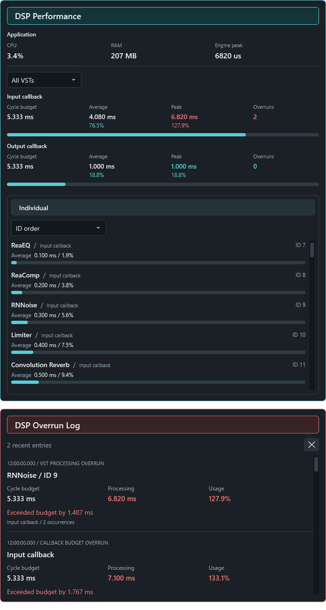

# DSP Performance And Overrun Log

Both sections are above the normal Log in the sidebar and start collapsed.
Click a section heading to open or close it. These diagnostics are included in
the [unsigned 0.8.3.8 development release](https://github.com/torment78/Elka.VoiceMeeterFxHost/releases/tag/v0.8.3.8).



*The actual application panel rendered with example data. These values illustrate
the controls and are not a benchmark or a live measurement.*

## DSP Performance

The **Application** section above the callback summaries contains the readings
previously shown in the top status bar:

- **CPU** is FX Host process CPU usage, normalized across logical processors.
  It is not the percentage of an audio-cycle budget.
- **RAM** is the process private working set, falling back to working set when
  Windows cannot supply the private figure. CPU and RAM include in-process VSTs
  but exclude separate plugin-worker processes.
- **Engine peak** is the highest current callback or ASIO processing peak,
  in microseconds. It uses the same 10-second peak windows as the callback
  summaries, so startup spikes expire at the next reset. It is not
  whole-application execution time. It shows `--` when there is no active
  measurement. Resetting peaks does not clear overrun history.

The top bar now shows green **Running** or red **Stop**, **Sample Rate** in kHz,
**Buffer** in samples, and **Cycle** in milliseconds. Cycle is the available
block-processing time, not end-to-end audio latency. Loading and scan progress
remain visible beneath that status when needed.

- **All VSTs** shows a summary for every active callback, with its cycle budget,
  average processing, peak processing and accumulated overrun count.
- Select **Input**, **Output**, **Main**, or **ASIO Patch** to inspect one cycle.
- Expand **Individual** to inspect the VSTs. **ID order** is the default, keeping
  the lowest ID at the top without moving rows as usage changes. Select
  **Highest average usage** to rank by percentage of each VST's audio-cycle budget.
  Five rows fit in the list; scroll to inspect the rest. Each row includes the
  plugin name, callback and VST ID on one line, with its average below.
- **Cycle budget** is the available time for one block: samples divided by sample
  rate. For example, 256 samples at 48,000 Hz gives about 5.333 ms.
- A slim bar below each callback summary shows its average budget usage: cyan
  below 80%, amber from 80%, and red at 100% or above. The bar stops at full width;
  the numeric percentage continues to show any usage above 100%.
- **Average** shows recent average elapsed processing per block in milliseconds
  and as a percentage of the cycle budget. **Peak** shows the highest recorded
  block in the current 10-second measurement window, in both units. Each callback
  starts a new window on its first completed block at or after 10 seconds.
  This resets only peaks, not averages, accumulated overruns or the log.
  Audio format changes and plugin reloads also reset the relevant measurements.
- Callback summaries show average, peak and overruns. Individual VST rows show
  only the average; their peak and overrun details remain in the hover popup.
  Values over 100% remain visible in red; only the bar length stops at 100%.
- Hover anywhere over a row for its full name, ID, callback, cycle budget,
  average, peak, accumulated budget-overrun count and measurement details.
  These hover details stay available as the values refresh.
- Callback processing includes host work. The VST average subtotal includes all
  processing VSTs in that cycle, not only the five displayed rows, and is available
  in the callback's hover details.

Input, Output, Main, and ASIO have separate budgets. **All VSTs** shows the
average and peak for every active callback above the optional plugin list.
It does not add independent callbacks
into one percentage or add individual plugin peaks into a fictitious total peak.

An occasional 7.2 ms block can coexist with a low average, but consistently
taking 7.2 ms against a 2.667 ms budget must produce an average around 270%.
The average and peak are different measurements; the overrun log preserves
individual bad blocks instead of the average.

These are elapsed processing measurements, not Windows Task Manager CPU
percentages. A sandboxed plugin's time includes communication with its worker
and any scheduling waits. Powered-off or unconnected plugins that are not
processing audio do not appear as active processing rows.

## DSP Overrun Log

An entry is recorded when a VST node or the complete callback takes longer than
its nominal audio-cycle budget. Entries show the timestamp, plugin name and
ID or callback name, budget, processing duration, usage, and excess time.

Repeated overruns for the same node and format are grouped approximately once
per second. Each entry shows the occurrence count and the worst measured event
in that group. The panel keeps the latest 200 entries. A VST overrun and its
callback overrun can both be logged; they are not two independent audio glitches.

An overrun is a timing warning, not proof of an audible glitch. A low measured
time also cannot rule out a driver, device, or callback-delivery problem.

Intermittent clicks in normal callback mode remain under investigation, including
reports with no increasing DSP overrun counts. Version 0.8.3.8 does not include
a confirmed fix for those clicks. The counters measure processing after callback
delivery, not late delivery or audio-sample continuity.

## Background Detection And Files

Detection and file logging continue when both panels are closed or FX Host is
in the tray. Panel rendering stops while hidden. Formatting and disk writes
run outside the audio threads; the audio path records only bounded timing data.
Timing measurement has a small overhead and does not change routing or samples.

The visible dashboard refreshes at a target of 30 Hz (about every 33.3 ms). Native
timing snapshots are published at up to 60 Hz on audio-block boundaries, and the
background reader polls about every 16.7 ms. Overrun detection still runs per block;
repeated log entries are grouped roughly once per second. These are diagnostic
refresh intervals, not audio sample rates or buffer settings.

Application CPU/RAM and the top-bar status keep the existing 500 ms status
refresh; CPU usage is sampled over at least 750 ms. The faster DSP display timer
does not add process-resource or engine-status queries.

The persistent log is stored at:

```text
%LOCALAPPDATA%\ElkaSoft\VoiceMeeterFxHost\dsp-overruns.log
```

The file rotates at about 5 MB, keeping one previous file as
`dsp-overruns.log.1`. Clearing the displayed entries does not delete these
files. If the bounded event queue fills, or overlapping callbacks prevent a
measurement, the panel reports the lost-event or skipped-measurement count.
